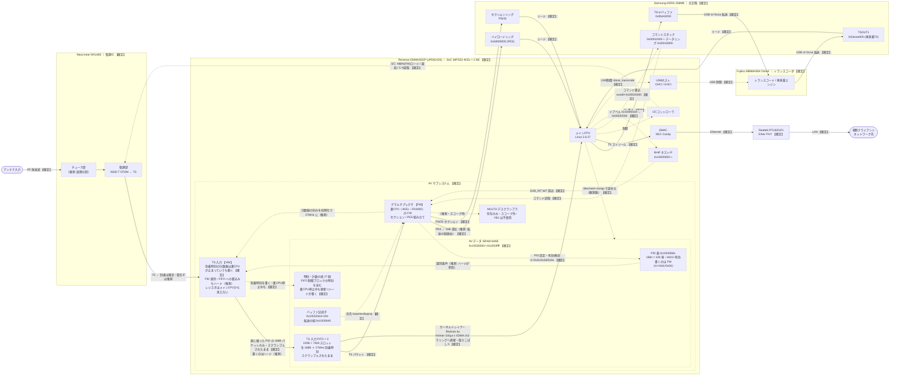
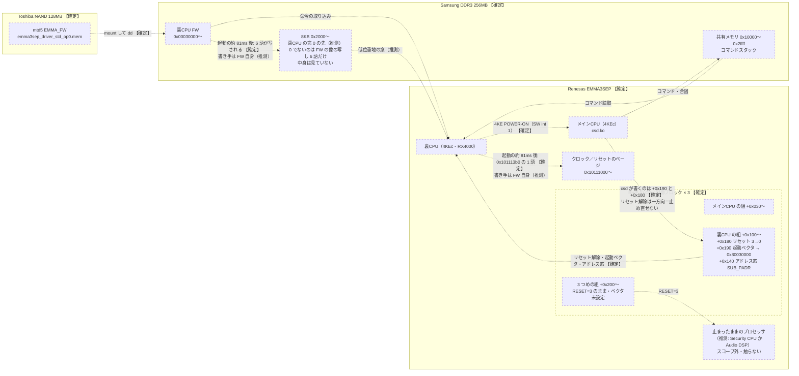

# POE-BR100-YB1 (BMMPX1301) 信号経路の俯瞰

<!-- openird-spec
Status: observing
As-of:  実機 POE-BR100-YB1 / ベンダ FW 2.1.17 r3 (2026-09-27・裏 CPU の起動と停止の実測を反映)
Impl:   -
Tests:  -
Note:   受信スタックの物理/論理構成の俯瞰図。詳細と根拠は poe-br100-yb1-reception-stack.md（受信スタック §番号）と poe-br100-yb1-subcpu-control.md（裏 CPU 制御 §番号）
-->

<!-- Open 層のみ: チップのシルク（現物・写真）、GPL カーネル・U-Boot のヘッダ、
     `strings`/`readelf`/`nm`、`/proc`、実機での runtime 観察、Renesas の公開資料。
     逆アセ由来の内部ロジックは置かない。 -->

放送データと制御が、どの物理 IC のどの論理ブロックを、どのバスで通るかを 1 枚に
まとめる。個々の根拠は [受信スタック仕様](poe-br100-yb1-reception-stack.md)（以下「受信 §」）と
[裏 CPU 制御仕様](poe-br100-yb1-subcpu-control.md)（以下「制御 §」）の該当節にある。

## 0. スコープ

限定受信（B-CAS / MULTI2 / ARIB スクランブル解除）は**永久に対象外**。本図では
デスクランブラは**存在を 1 ノード置くだけ**で、データ経路も制御手順も描かない。
なお **YB1 はカードスロットを持たない**（§7・地デジ単チューナ・録画ライト）ので、
その論理ブロックは実機では使われない。公開資料にある EMMA3SE/P の **Security CPU** の
候補（§2.2 の「止まったままのプロセッサ」）も同じ扱いで、存在を置くだけにする。

## 1. 凡例

- **ノード**
  - 実線の枠（subgraph / 角丸なし）＝**物理 IC**。
  - 破線の枠（`stroke-dasharray`）＝IC 内部の**論理ブロック**。
  - ラベルの **【HW】** ＝ハードウェアが行う、**【FW】** ＝裏 CPU の FW が行う。
- **エッジ**
  - 実線 `──▶`＝**放送データの流れ**。
  - 点線 `┈▶`＝**制御の流れ**（設定・ファーム転送・割り込み・コマンド）。
    メイン CPU が**読むだけ**の観測路（`MAIN ┈▶ SRAM`）もこの線で描く。
  - ラベルに**バスの種類 / 制御内容 / データ内容**を書く。
- **確度**: `【確定】`＝実機観察で裏が取れている。`（推測）`＝未実測の仮説。

## 2. 図

### 2.1 放送データの流れ

> **図の簡略化について（読み手向けの注記）**: トランスコーダ（MB86H58A）との
> TS 授受は**すべて USB（`/dev/h57fmb0`）上の `nr=0x1a` 転送**である。図では
> DRAM ↔ トランスコーダを直結の実線で描き、USB がその輸送路であることは
> 制御エッジ `USBH ┈▶ TRC` で表している。物理的には DRAM ↔ トランスコーダの
> データも USB ホストを経由する。

### 2.2 裏 CPU の起動と制御

> **停止の口は無い**: 裏 CPU のリセット解除（`+0x180`）は、メイン CPU から書いても戻らない
> （制御 §5.3/§5.5）。起動の順番（20µs ごとの見張り）は受信 §79.2。`rmmod csd` でも裏 CPU は止まらない。電源を切らずに
> AV をやり直すには csd を入れ直し、**走っている FW に初期化をやり直させる**（制御 §5.2・
> `tools/vendor-rootfs/av-restart.sh`）。

## 3. ノード（物理 IC と論理ブロック）

| 物理 IC | 論理ブロック | 確度 | 根拠 |
|---|---|---|---|
| **MaxLinear MXL683**（復調） | チューナ部 | IC 確定 / 内部分割は推測 | 受信 §7・現物 |
| | 復調部（ISDB-T OFDM→TS） | 【確定】 | 受信 §30（選局・ロック・C/N を実機で実行） |
| **Renesas EMMA3SEP**（SoC） | メイン CPU（MIPS32 4KEc・Linux 2.6.27） | 【確定】 | 受信 §1・Renesas 公開資料（制御 §1） |
| | I2C コントローラ | 【確定】 | 受信 §28/§30（`i2c-emma`） |
| | BHIF ホスト IF（`0x10000000〜`） | 【確定】 | 受信 §72・GPL `emma3sep.h` |
| | ├ **CPU 制御ブロック × 3**（割り込み・NMI・アドレス窓・リセット・起動ベクタ） | 【確定】（一部の名前は推測） | 制御 §2/§3。名前は GPL U-Boot `emmaregs.h` |
| | クロック／リセットのページ（`0x10111000〜`） | 【確定】 | 制御 §5.5。裏 CPU の起動の約 81 ms 後に `0x101113b0` の 1 語が変わる（受信 §79.2） |
| | USB ホスト（OHCI/EHCI） | 【確定】 | GPL `platform.c`・`h57fmb.ko` |
| | EMAC（NEC-Candy） | 【確定】 | 受信 §7・GPL |
| | AV サブシステム | 【確定】 | 受信 §66/§72（コマンドスタック＋合図） |
| | ├ **裏 CPU（MIPS32 4KEc・RX4000）** | 【確定】 | 制御 §1（公開資料・`strings`）/§5（リセット解除は csd、止め直しはできない）・受信 §79（起動の順番） |
| | ├ **TS 入力【HW】** | 時刻の計数器が HW なのは【確定】／PID 選別と FIFO への書き込みが HW かは推測 | 制御 §5.4（裏 CPU 停止中も時刻が進む）。受信 §73.6（FIFO に入るのは表の PID だけ）。**制御・状態のレジスタはメイン CPU から見える窓に無い**（受信 §73.3〜§73.5） |
| | ├ **AV データ SRAM 64KB**（`0x10030000`〜`0x1003ffff`） | 【確定】 | 受信 §73.2。`nr=0x01`（Initialise）で約 1 万語が書かれる。メイン CPU から `/dev/mem` の mmap で読める |
| | │ ├ PID 表（`0x1003066c`・16bit×108 項） | 【確定】 | 受信 §73.4。添字＝フィルタ番号、bit15＝有効、下位 13bit＝PID、未使用 `0x1fff`。公開資料の「108 PID フィルタ」と一致 |
| | │ ├ TS 入力 FIFO ×3（220B×7/6/8 スロット） | 【確定】 | 受信 §73.6/§73.9/§77.3。生 188B＋27MHz 到着時刻。**映像 PID を載せるとスクランブルされたまま入る**。制御ブロック `0x1003ec00`/`ec80`/`ed00` |
| | │ ├ **時刻・計数の語 27 個** | 【確定】 | 制御 §5.4。**裏 CPU がリセットで止まっている間も更新される＝ハードが書く**。FIFO 制御ブロックの `+0x54`（到着時刻の刻み）を含む |
| | │ └ バッファ記述子（`0x100333e4`＋20n）／転送の組（`0x1003fd40`） | 記述子【確定】／転送の組の役割は推測 | 受信 §73.3。リング番地を持つのはここ（12 語）だけ |
| | ├ デマルチプレクサ【FW】 | 【確定】 | 受信 §43（PES）/§55.1（セクション）/§70。FIFO のパケットからセクション／PES を組み立てる（受信 §73.6） |
| | └ MULTI2 デスクランブラ | 存在のみ・スコープ外 | `val_dscram`/`val_m2dsc` 列挙のみ。YB1 は不使用 |
| | 止まったままのプロセッサ（3 つめの制御ブロック） | 存在【確定】／正体は推測 | 制御 §3.3。RESET=`3` のまま。**Security CPU の可能性があるので触らない** |
| **Samsung DDR3 256MB** | 裏 CPU FW（`0x30000`） | 【確定】 | 制御 §5（`dd` で置く・起動ベクタ `0x80030000`） |
| | 8KB（`0x2000`・裏 CPU の窓 0 の先） | 置き場と中身の出所は【確定】／役割は推測 | 制御 §4/§5.1・受信 §79.1。0 でないのは FW の像の写しの 6 語だけ |
| | コマンドスタック（`0x10400`）＋リング（`0x10800`） | 【確定】 | 受信 §66/§72 |
| | セクションリング（PSI/SI） | 【確定】 | 受信 §55.1 |
| | ペイロードリング（`0x0d000000`・PES） | 【確定】 | 受信 §43 |
| | TS-in バッファ（`0x0b442000`） | 【確定】 | 受信 §58.3 |
| | TSOUT1（`0x0acea000`・再多重 TS） | 【確定】 | 受信 §55/§58.3 |
| **Fujitsu MB86H58A 'Dione'**（トランスコーダ） | トランスコード/再多重エンジン | 【確定】 | 受信 §57/§58/§62 |
| **Realtek RTL8201FL** | Ether PHY | 【確定】 | 受信 §7 |

> **FW の在り処**: 2 種の FW はいずれも **NAND 上に静的に置かれ、メイン CPU が読み出して
> 各 IC へ流し込む**。NAND 自身は何も制御しない。
> ①**裏CPU FW** = mtd5（`[5]EMMA_FW` squashfs）内の `emma3sep_driver_std_op0.mem`（§2.2）。
> ②**MXL683 の MBIN** = rootfs 側 `blur` の `.rodata` に生で 1 個（受信 §28）。

## 4. エッジ（放送データ＝実線 / 制御＝点線）

| 種別 | 経路 | バス / 内容 | 確度 | 根拠 |
|---|---|---|---|---|
| データ | ANT → MXL683 | RF 放送波 | 【確定】 | 受信 §30 |
| データ | MXL683 → TS 入力 | TS（到達は確定・**電気 IF は推測**） | 到達【確定】/IF（推測） | 受信 §60/§65 |
| データ | TS 入力 → SRAM FIFO | **PID 表に載った PID の 188B パケットだけ**（到着時刻つき）。全 PID 素通し（`nr=0x48 {機器,0}`）でも増えない。**映像 PID `0x0100` は scrambling_control 2/3 のまま毎秒約 9,140 本（13.75 Mbps）**。PID 表の有効ビットを落としても（`nr=0x0e`）、ioctl のプロセスが終わっても、`rmmod csd` しても同じ勢いで入り続ける。**書いているのはハード（推測）**——裏 CPU の停止中に時刻の語が書かれるのは確定（制御 §5.4）だが、停止中にパケットが入るかは、裏 CPU を止め直せないため確かめられていない | 振る舞い【確定】／書き手は推測 | 受信 §73.6/§73.9・制御 §5.3/§5.4 |
| データ | SRAM FIFO → DEMUX | TS パケット（裏 CPU FW が読む） | 【確定】 | 受信 §73.6 |
| データ | SRAM FIFO → メイン CPU | **OpenIRD のカーネルドレイナー**（`fifodrain.ko`）。hrtimer で 100µs ごとに、**XDMA チャネル 2**（GPL の NAND ドライバと同じ手順・`MEM_LIST3 = 0x38000000`）に SRAM のスロットをリングへ直接運ばせ、`/dev` から 188B 単位で読める。多重の全 PID でヌル以外 100%・参照受信機とビット一致 | 【確定】 | 受信 §74/§75/§77 |
| データ | DEMUX → ペイロードリング | PES。宛先の end は 16B 境界。転送の組（`0x1003fd40`）経由は推測 | 【確定】 | 受信 §43/§73.3 |
| データ | DEMUX → セクションリング | PSI/SI セクション | 【確定】 | 受信 §55.1 |
| データ | リング → メイン CPU | DRAM リード | 【確定】 | 受信 §43/§55.1 |
| データ | メイン CPU → TS-in バッファ | DRAM ライト | 【確定】 | 受信 §58 |
| データ | TS-in ↔ トランスコーダ ↔ TSOUT1 | **USB**（`nr=0x1a` 転送） | 【確定】 | 受信 §58/§62 |
| データ | メイン CPU → EMAC → PHY → クライアント | TS ストリーム→Ethernet→LAN | 【確定】 | ベンダ `WirelessDtvStreaming` |
| 制御 | メイン CPU → I2C → MXL683 | **I2C**：MBIN(FW) ロード / 選局 / C/N 読取 | 【確定】 | 受信 §28/§30 |
| 制御 | NAND → DRAM（裏 CPU FW） | メイン CPU が mtd5 を mount して `dd`（物理 `0x30000`） | 【確定】 | 制御 §5 |
| 制御 | メイン CPU → BHIF の裏 CPU の組 | csd が `insmod` の最中に書くのは `+0x190`（起動ベクタ）と `+0x180`（リセット解除）、ほかに `+0x1a4`（割り込みの登録）。**`+0x180` のリセット解除は一方向**（`3` を書いても戻らない）。`+0x1ac`・`+0x110`・`+0x1b4` は裏 CPU の合図の直後に書かれる（csd か FW かは未判別） | 【確定】 | 制御 §5.1/§5.3・受信 §79.2 |
| 制御 | 裏 CPU → クロック／リセットのページ | 起動の約 81 ms 後に `0x101113b0` の 1 語（`0a220000` → `00020000`）。書き手は FW 自身とみられる。`0x10111030`/`034`/`058` は起動と関係しない（制御 §5.5 の訂正） | 変化【確定】／書き手は推測 | 制御 §5.5・受信 §79.2 |
| 制御 | FW の像 → DRAM `0x2000` の 8KB | 起動の約 81 ms 後に、FW の像の 6 語がベクタの位置に写される（中身は見ていない）。書き手は FW 自身とみられる | 出所と時刻【確定】／書き手と役割は推測 | 制御 §5.1・受信 §79.1/§79.2 |
| 制御 | BHIF → 裏 CPU | リセット解除・起動ベクタ `0x80030000`・アドレス窓（窓 0 → `0x2000`） | 【確定】（窓の向きは推測） | 制御 §3.2/§4 |
| 制御 | 裏 CPU → メイン CPU | `4KE POWER-ON`（SW int 1・`CSD_SPECIAL`）。電源を切らないやり直しのたびに 1 増える | 【確定】 | 制御 §5.1/§5.2 |
| 制御 | メイン CPU → コマンドスタック | DRAM ライト（`word0=0x00020000`） | 【確定】 | 受信 §72.4 |
| 制御 | メイン CPU → BHIF | ドアベル `0x100001b0 ← 0x00020000` | 【確定】 | 受信 §72.3 |
| 制御 | BHIF → 裏 CPU | `SUB_INT` bit7 割り込み | 【確定】 | 受信 §72.2 |
| 制御 | コマンドスタック → DEMUX | 裏 CPU がコマンド読取 | 【確定】 | 受信 §66/§72.5 |
| 制御 | DEMUX → PID 表 | `nr=0x0c`（PID）・`0x0d`（有効）・`0x0e`（無効＝bit15 を落とす。**FIFO への流入は止まらない**） | 【確定】 | 受信 §73.4/§73.9 |
| 制御 | DEMUX（FW）→ TS 入力 | 計数器の刻みの設定。FIFO 制御ブロックの時刻が、FW の初期化前は約 46 MHz、稼働中は 27.000 MHz | 刻みの変化は【確定】／FW が設定しているのは推測 | 制御 §5.4 |
| 制御 | PID 表 → TS 入力 | 選別条件。**全パケットが FIFO を通るのではない**ことは実測から言える。選別をハードがやっているか（FW が別の場所から写している可能性）は推測。bit15 は門ではない（PID 値か、見えないレジスタか） | 推測 | 受信 §73.6/§73.9 |
| 制御 | TS 入力 → 時刻・計数の語 | **裏 CPU が止まっていても書かれる** | 【確定】 | 制御 §5.4 |
| 制御 | バッファ記述子 → DEMUX | 宛先の base / end / wp / rp | 【確定】 | 受信 §73.3 |
| 観測 | メイン CPU → AV データ SRAM | `/dev/mem` の mmap で**読める**（書いていない） | 【確定】 | 受信 §73.2 |
| 制御 | メイン CPU → USB → トランスコーダ | **USB**：`dione_transcode` | 【確定】 | 受信 §57 |

## 5. この図が示す含意

1. **復調器は Dione のピンを直接食わせていない**（受信 §65）。TS は必ず
   `MXL683 → TS 入力 → SRAM FIFO →（裏 CPU の FW か、メイン CPU のドレイナー）→ DRAM` を通り、
   トランスコーダへは `メイン CPU → USB` で回り込む。
2. **188 バイトの生 TS が、スクランブルされたまま、メイン CPU から読める SRAM の
   FIFO に現れる**（受信 §73.9）。**PID 表に載った PID に限られ**（受信 §73.6）、スロットは
   7/6/8 個で回り続ける。デマルチプレクサの出口は PES / PSI-SI セクションで、生 TS を DRAM に
   落とす出口は AV の関数表に無い（受信 §70.6）。**その SRAM からは、メイン CPU のカーネルが
   hrtimer で吸えば取りこぼしなく取り出せる**（受信 §74/§77）。
3. **AV サブシステムは「ハード（TS 入力）」と「FW（組み立て）」の 2 層になっている**
   （制御 §5.4）。
   - **ハード**: TS 入力は、少なくとも**到着時刻を刻む部分が裏 CPU と独立に動く**
     （裏 CPU がリセットで止まっている間も SRAM の時刻・計数の語が更新される＝確定）。
     PID 選別と FIFO へのパケットの書き込みもハードとみるのが自然で（有効ビットを落としても、
     プロセスが終わっても、csd を外しても流入が止まらない）、**FIFO への取り込みは 1 パケット
     ごとの FW の仕事ではない**可能性が高い（推測）。
   - **FW**: その**設定**（PID 表を書く・計数器の刻みを 27 MHz に合わせる）と、FIFO の中身から
     セクション/PES を**組み立てる**のは裏 CPU の FW。
   - ∴ **「設定は FW、取り込みはハード」**。生 TS の取り出し（§2.1 のドレイナー）が裏 CPU の
     FW に 1 パケットごとに頼っていない、という本線の前提と合う。自前 FW を書く場合も、
     TS 入力のハードを動かすのは「設定」だけで、パケットを運ぶ仕事は要らない見込み。
   - **確かめられていないこと**: 裏 CPU を止めた状態でパケットが FIFO に入るか。裏 CPU は
     メイン CPU から止め直せない（4 の 2）ので、今の道具では試せない。
4. **裏 CPU はメイン CPU が起こすが、止め直せない**（§2.2・制御 §5）。
   - csd がしているのは起動ベクタ（`+0x190`）とリセット解除（`+0x180`）の 2 語と割り込みの登録で、
     その後のクロック／リセットの 1 語・8KB の 6 語・共有メモリの 0 埋めは、起動した FW 自身が
     しているとみられる（受信 §79.2・推測）。
   - リセット解除は一方向で、`rmmod csd` でも止まらない。電源を切らないやり直しは、
     **走っている FW に初期化をやり直させる**形（制御 §5.2・`av-restart.sh`）。
   - 自前 FW の入れ替えも、FW が協力する形（常駐ローダ）にする必要がある（制御 §5.6）。
5. **TS 入力・DMA のハードのレジスタは、メイン CPU から見える窓に無い**（受信 §73.3〜§73.5）。
   BHIF／XDMA／TIMER と `0x10000000`〜`0x100fffff` の全域（Ether 除く）、クロック／リセットの
   ページも見たが、TS 入力の制御・状態に当たる語は無かった。見えるのは裏 CPU のデータ SRAM
   （FW の変数とハードが書く語）だけ。
6. **制御は 4 系統に分かれる**：フロントエンドは **I2C**、AV のコマンドは
   **BHIF ドアベル＋共有メモリ**、裏 CPU の起動は **BHIF の CPU 制御ブロック**、トランスコーダは
   **USB**。フロントエンドと AV のコマンドは自前で叩けることを確かめてある（受信 §30・§72）。
   裏 CPU の起動は、いまは csd に頼っている（起動の順番は受信 §79。csd を使わない起動は未検証）。

## 6. 未確定（次に埋めるべき点）

- **MXL683 → SoC の TS 電気インターフェース**（パラレル TS か同期シリアルか、
  何ピンか）。データ到達は確定だが電気的詳細は未観察。公開資料では TS 入力は
  「2 × シリアルまたは 1 × パラレル」（制御 §1）。
- **FIFO へのパケットの書き手はハードか**（§5 の 3）。時刻の語がハードなのは確定。パケットは、
  裏 CPU を止めた状態で TS を流せないため未確認。自前の最小 FW（何もしない FW）で裏 CPU を
  起こした状態で PID 表だけ載せる、などの形なら確かめられる見込み。
- **FIFO の入口の門は何か**。PID 表の bit15 ではない（受信 §73.9）。PID 値か、
  メイン CPU から見えないレジスタか。
- **PID 選別と FIFO 書き込みを行うハードのレジスタの所在**。メイン CPU から見える
  窓には無い（受信 §73.7・§5 の 5）。`0x11000000` の窓は読むと止まる（受信 §54.1。公開資料の
  「GIO バス」の窓と見られる・制御 §12）。
- **裏 CPU を止め直す口**（制御 §5.3/§5.5 で BHIF とクロック／リセットのページには無いと確認）。
  残る候補は基板の EJTAG（制御 §9）。
- デスクランブラの図上の位置（`DEMUX ┈▶ DSCRAM`）。OpenIRD の構成では FIFO に
  スクランブルされたまま入ることが分かったので、段階 C には影響しない。ベンダの
  構成（鍵あり）での位置は、スコープ外のため確かめない。
- **転送の組（`0x1003fd40`）が、ハードの読む記述子か FW の変数か**。読むだけの
  観測では区別できない。
- トランスコーダ出力を最終的に**クライアントへ流す経路の全長**（EMAC までは確定、
  ソケットバッファ・多重化の詳細は未仕様化）。
