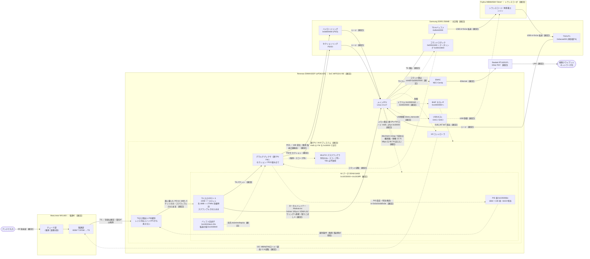

# POE-BR100-YB1 (BMMPX1301) 信号経路の俯瞰

<!-- openird-spec
Status: observing
As-of:  実機 POE-BR100-YB1 / ベンダ FW 2.1.17 r3 (2026-09-27)
Impl:   -
Tests:  -
Note:   受信スタックの物理/論理構成の俯瞰図。詳細と根拠は poe-br100-yb1-reception-stack.md（§番号で相互参照）
-->

<!-- Open 層のみ: チップのシルク（現物・写真）、GPL カーネルのヘッダ、
     `strings`/`readelf`/`nm`、`/proc`、実機での runtime 観察。
     逆アセ由来の内部ロジックは置かない。 -->

放送データと制御が、どの物理 IC のどの論理ブロックを、どのバスで通るかを 1 枚に
まとめる。個々の根拠は [poe-br100-yb1-reception-stack.md](poe-br100-yb1-reception-stack.md)
の該当節にある。

## 0. スコープ

限定受信（B-CAS / MULTI2 / ARIB スクランブル解除）は**永久に対象外**。本図では
デスクランブラは**存在を 1 ノード置くだけ**で、データ経路も制御手順も描かない。
なお **YB1 はカードスロットを持たない**（§7・地デジ単チューナ・録画ライト）ので、
その論理ブロックは実機では使われない。

## 1. 凡例

- **ノード**
  - 実線の枠（subgraph / 角丸なし）＝**物理 IC**。
  - 破線の枠（`stroke-dasharray`）＝IC 内部の**論理ブロック**。
- **エッジ**
  - 実線 `──▶`＝**放送データの流れ**。
  - 点線 `┈▶`＝**制御の流れ**（設定・ファーム転送・割り込み・コマンド）。
    メイン CPU が**読むだけ**の観測路（`MAIN ┈▶ SRAM`）もこの線で描く。
  - ラベルに**バスの種類 / 制御内容 / データ内容**を書く。
- **確度**: `【確定】`＝実機観察で裏が取れている。`（推測）`＝未実測の仮説。

## 2. 図

> **図の簡略化について（読み手向けの注記）**: トランスコーダ（MB86H58A）との
> TS 授受は**すべて USB（`/dev/h57fmb0`）上の `nr=0x1a` 転送**である。図では
> DRAM ↔ トランスコーダを直結の実線で描き、USB がその輸送路であることは
> 制御エッジ `USBH ┈▶ TRC` で表している。物理的には DRAM ↔ トランスコーダの
> データも USB ホストを経由する。

## 3. ノード（物理 IC と論理ブロック）

| 物理 IC | 論理ブロック | 確度 | 根拠 |
|---|---|---|---|
| **MaxLinear MXL683**（復調） | チューナ部 | IC 確定 / 内部分割は推測 | §7・現物 |
| | 復調部（ISDB-T OFDM→TS） | 【確定】 | §30（選局・ロック・C/N を実機で実行） |
| **Renesas EMMA3SEP**（SoC） | メイン CPU（Linux 2.6.27） | 【確定】 | §1 |
| | I2C コントローラ | 【確定】 | §28/§30（`i2c-emma`） |
| | BHIF ホスト IF（`0x10000000〜`） | 【確定】 | §72・GPL `emma3sep.h` |
| | USB ホスト（OHCI/EHCI） | 【確定】 | GPL `platform.c`・`h57fmb.ko` |
| | EMAC（NEC-Candy） | 【確定】 | §7・GPL |
| | 裏 CPU / AV サブシステム | 【確定】 | §66/§72（コマンドスタック＋合図） |
| | ├ TS 入力取込＋PID 選別 | 振る舞い【確定】／レジスタ所在は不明 | §73.6（FIFO に入るのは表の PID だけ）。**制御・状態のレジスタはメイン CPU から見える窓に無い**（§73.3〜§73.5） |
| | ├ **AV データ SRAM 64KB**（`0x10030000`〜`0x1003ffff`） | 【確定】 | §73.2。裏 CPU のデータメモリ。`nr=0x01`（Initialise）で約 1 万語が書かれる。メイン CPU から `/dev/mem` の mmap で読める |
| | │ ├ PID 表（`0x1003066c`・16bit×108 項） | 【確定】 | §73.4。添字＝フィルタ番号、bit15＝有効、下位 13bit＝PID、未使用 `0x1fff` |
| | │ ├ TS 入力 FIFO ×3（220B×7 スロット） | 【確定】 | §73.6/§73.9。生 188B＋27MHz 到着時刻。**映像 PID を載せるとスクランブルされたまま入る**。制御ブロック `0x1003ec00`/`ec80`/`ed00` |
| | │ └ バッファ記述子（`0x100333e4`＋20n）／転送の組（`0x1003fd40`） | 記述子【確定】／転送の組の役割は推測 | §73.3。リング番地を持つのはここ（12 語）だけ |
| | ├ デマルチプレクサ（裏 CPU FW） | 【確定】 | §43（PES）/§55.1（セクション）/§70。FIFO のパケットからセクション／PES を組み立てる（§73.6） |
| | └ MULTI2 デスクランブラ | 存在のみ・スコープ外 | `val_dscram`/`val_m2dsc` 列挙のみ。YB1 は不使用 |
| **Samsung DDR3 256MB** | コマンドスタック（`0x10400`）＋リング（`0x10800`） | 【確定】 | §66/§72 |
| | セクションリング（PSI/SI） | 【確定】 | §55.1 |
| | ペイロードリング（`0x0d000000`・PES） | 【確定】 | §43 |
| | TS-in バッファ（`0x0b442000`） | 【確定】 | §58.3 |
| | TSOUT1（`0x0acea000`・再多重 TS） | 【確定】 | §55/§58.3 |
| **Fujitsu MB86H58A 'Dione'**（トランスコーダ） | トランスコード/再多重エンジン | 【確定】 | §57/§58/§62 |
| **Realtek RTL8201FL** | Ether PHY | 【確定】 | §7 |

> **FW の在り処**（図には描かない）: 2 種の FW はいずれも **NAND 上に静的に置かれ、
> メインCPU が読み出して各 IC へ流し込む**。NAND 自身は何も制御しない。
> ①**裏CPU FW** = mtd5（`[5]EMMA_FW` squashfs）内の `emma3sep_driver_std_op0.mem`。
> ②**MXL683 の MBIN** = rootfs 側 `blur` の `.rodata` に生で 1 個（§28）。

## 4. エッジ（放送データ＝実線 / 制御＝点線）

| 種別 | 経路 | バス / 内容 | 確度 | 根拠 |
|---|---|---|---|---|
| データ | ANT → MXL683 | RF 放送波 | 【確定】 | §30 |
| データ | MXL683 → 裏CPU(TS入力) | TS（到達は確定・**電気 IF は推測**） | 到達【確定】/IF（推測） | §60/§65 |
| データ | TS 入力 → SRAM FIFO | **PID 表に載った PID の 188B パケットだけ**（到着時刻つき）。全 PID 素通し（`nr=0x48 {機器,0}`）でも増えない。**映像 PID `0x0100` は scrambling_control 2/3 のまま毎秒約 9,140 本（13.75 Mbps）** | 【確定】 | §73.6/§73.9 |
| データ | SRAM FIFO → DEMUX | TS パケット（裏 CPU FW が読む） | 【確定】 | §73.6 |
| データ | SRAM FIFO → メイン CPU | **OpenIRD のカーネルドレイナー**（`fifodrain.ko`）。hrtimer で 100µs ごとに、**XDMA チャネル 2**（GPL の NAND ドライバと同じ手順・`MEM_LIST3 = 0x38000000`）に SRAM のスロットをリングへ直接運ばせ、`/dev` から 188B 単位で読める。映像 PID 30 秒・28 万本で取りこぼし 0。CPU は 1 パケット約 2.8µs（CPU コピーなら 15.5µs） | 【確定】 | §74/§75 |
| データ | DEMUX → ペイロードリング | PES。宛先の end は 16B 境界。転送の組（`0x1003fd40`）経由は推測 | 【確定】 | §43/§73.3 |
| データ | DEMUX → セクションリング | PSI/SI セクション | 【確定】 | §55.1 |
| データ | リング → メイン CPU | DRAM リード | 【確定】 | §43/§55.1 |
| データ | メイン CPU → TS-in バッファ | DRAM ライト | 【確定】 | §58 |
| データ | TS-in ↔ トランスコーダ ↔ TSOUT1 | **USB**（`nr=0x1a` 転送） | 【確定】 | §58/§62 |
| データ | メイン CPU → EMAC → PHY → クライアント | TS ストリーム→Ethernet→LAN | 【確定】 | ベンダ `WirelessDtvStreaming` |
| 制御 | メイン CPU → I2C → MXL683 | **I2C**：MBIN(FW) ロード / 選局 / C/N 読取 | 【確定】 | §28/§30 |
| 制御 | メイン CPU → 裏 CPU | **メモリ書込(DRAM)**：裏CPU FW ロード（mtd5 読出し → phys `0x30000`） | 【確定】 | §7・`setup.sh` |
| 制御 | メイン CPU → コマンドスタック | DRAM ライト（`word0=0x00020000`） | 【確定】 | §72.4 |
| 制御 | メイン CPU → BHIF | ドアベル `0x100001b0 ← 0x00020000` | 【確定】 | §72.3 |
| 制御 | BHIF → 裏 CPU | `SUB_INT` bit7 割り込み | 【確定】 | §72.2 |
| 制御 | コマンドスタック → DEMUX | 裏 CPU がコマンド読取 | 【確定】 | §66/§72.5 |
| 制御 | DEMUX → PID 表 | `nr=0x0c`（PID）・`0x0d`（有効）・`0x0e`（無効＝bit15 を落とす。**FIFO への流入は止まらない**） | 【確定】 | §73.4/§73.9 |
| 制御 | PID 表 → TS 入力 | 選別条件。**全パケットが FIFO を通るのではない**ことは実測から言える。選別をハードがやっているか（FW が別の場所から写している可能性）は推測。bit15 は門ではない（PID 値か、見えないレジスタか） | 推測 | §73.6/§73.9 |
| 制御 | バッファ記述子 → DEMUX | 宛先の base / end / wp / rp | 【確定】 | §73.3 |
| 観測 | メイン CPU → AV データ SRAM | `/dev/mem` の mmap で**読める**（書いていない） | 【確定】 | §73.2 |
| 制御 | メイン CPU → USB → トランスコーダ | **USB**：`dione_transcode` | 【確定】 | §57 |

## 5. この図が示す 4 つの含意

1. **復調器は Dione のピンを直接食わせていない**（§65）。TS は必ず
   `MXL683 → 裏CPU（TS 入力 → SRAM FIFO → デマルチプレクサ）→ DRAM` を通り、
   トランスコーダへは `メイン CPU → USB` で回り込む。図の実線がその一本道である。
2. **188 バイトの生 TS が、スクランブルされたまま、メイン CPU から読める SRAM の
   FIFO に現れる**（§73.9。映像 PID で scrambling_control 2/3・平文 0）。ただし
   **PID 表に載った PID に限られ**（§73.6）、スロットは 7 個で裏 CPU が回し続ける。
   デマルチプレクサの出口は PES / PSI-SI セクションで、生 TS を DRAM に落とす出口は
   AV の関数表に無い（§70.6）。∴ ハードは生 TS を **SRAM までは**運んでおり、
   そこから先（組み立て）を担うのが裏 CPU の FW である。**その SRAM からは、メイン CPU の
   カーネルが hrtimer で吸えば取りこぼしなく取り出せる**（§74）。
3. **TS 入力・DMA のハードのレジスタは、メイン CPU から見える窓に無い。**
   BHIF／XDMA／TIMER と `0x10000000`〜`0x100fffff` の全域（Ether 除く）を
   リング番地 X/Y・取込 ON/OFF・ロック有無で差分しても 0 語だった（§73.3〜§73.5）。
   見えるのは裏 CPU のデータ SRAM（FW の変数）だけで、レジスタ番地は読むだけの
   観測では出ない。
4. **制御は 3 系統に分かれる**：フロントエンドは **I2C**、AV は
   **BHIF ドアベル＋共有メモリ**、トランスコーダは **USB**。段階 C の
   クリーン実装はこの 3 系統をそれぞれ自前で叩けばよい（ドアベルは §72 で確定）。

## 6. 未確定（次に埋めるべき点）

- **MXL683 → SoC の TS 電気インターフェース**（パラレル TS か同期シリアルか、
  何ピンか）。データ到達は確定だが電気的詳細は未観察。
- **多重の全 PID を PID 表（108 項）に載せたとき、FIFO が運ぶ量が TS 全体に
  どこまで近づくか**（部分 TS の網羅率。§73.10）。
- **FIFO の入口の門は何か**。PID 表の bit15 ではない（§73.9）。PID 値か、
  メイン CPU から見えないレジスタか。
- **FIFO を吸うコスト**。XDMA でリングへ直接運ばせて、コールバックは CPU 約 5%（映像
  1 本）まで下がった（§75）。残るのは読み手側の `copy_to_user` と、多重全体での負荷（未実測）。
- **PID 選別と FIFO 書き込みを行うハードのレジスタの所在**。メイン CPU から見える
  窓には無い（§73.7）。`0x11000000` の窓は読むと止まる（§54.1）。
- デスクランブラの図上の位置（`DEMUX ┈▶ DSCRAM`）。OpenIRD の構成では FIFO に
  スクランブルされたまま入ることが分かったので、段階 C には影響しない。ベンダの
  構成（鍵あり）での位置は、スコープ外のため確かめない。
- **転送の組（`0x1003fd40`）が、ハードの読む記述子か FW の変数か**。読むだけの
  観測では区別できない。
- トランスコーダ出力を最終的に**クライアントへ流す経路の全長**（EMAC までは確定、
  ソケットバッファ・多重化の詳細は未仕様化）。
