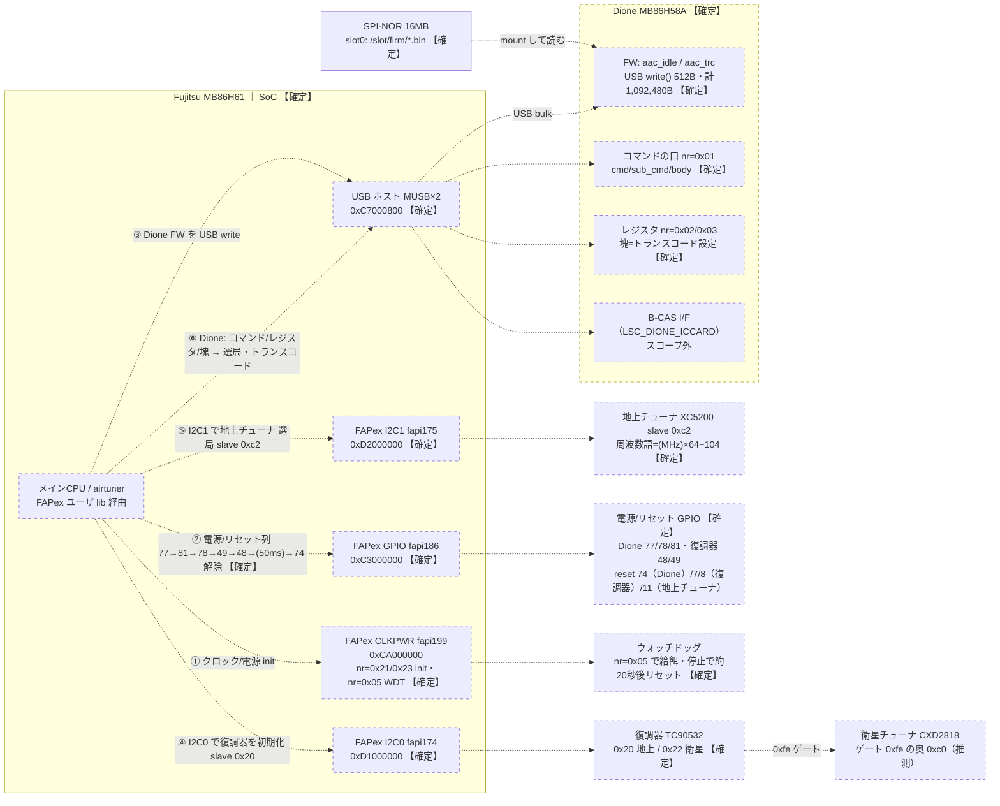

# SB-TV02-WFPL 信号経路の俯瞰

<!-- openird-spec
Status: observing
As-of:  実機 SB-TV02-WFPL / ベンダ airtuner 1.0.3 r763 (2026-09-29 受信の位相を確定 → 2026-09-30 自前立ち上げ・idle・カード抜きで生TS不可を確定・補強)
Impl:   -
Tests:  -
Note:   受信スタックの物理/論理構成の俯瞰図。詳細と根拠は sb-tv02-wfpl-stage-b-fapex.md（以下「FAPex §」）と sb-tv02-wfpl-vendor-boot.md（以下「起動 §」）。作例は poe-br100-yb1-signal-flow.md。
-->

<!-- Open 層のみ: チップのシルク（現物・写真）、GPL カーネル（linux-2.6.31.6-rt19）と
     FAPexK/FAPexU の公開ソースの静的読み、`strings`/`readelf`/`nm`、`/proc`、
     LD_PRELOAD の ioctl/write トレース、`/dev/mem` の TS 走査（0x47 同期・スクランブル統計）、
     実機での runtime 観察。逆アセ由来の内部ロジック・コード由来の数式・限定受信の鍵/手順は
     含まない。【確定】＝実機/写真で確認、（推測）＝状況証拠からの推定。 -->

放送データと制御が、どの物理 IC のどの論理ブロックを、どのバスで通るかを 1 枚に
まとめる。個々の根拠は [FAPex 契約仕様](sb-tv02-wfpl-stage-b-fapex.md)（以下「FAPex §」）と
[ベンダ起動仕様](sb-tv02-wfpl-vendor-boot.md)（以下「起動 §」）の該当節にある。

## 0. スコープと、この機の特徴

限定受信（B-CAS / MULTI2 / ARIB スクランブル解除）は**永久に対象外**。デスクランブラは
**存在を 1 ノード置くだけ**で、データ経路も制御手順も描かない。

**この機の要点（YB1 との最大の違い）**: 復号は**独立した外部チップ Dione（MB86H58A）の
中でインラインに行われ、B-CAS カードも Dione 配下にある**（FAPex §5.8）。復調器の生
（スクランブルのまま）TS は Dione に入り、SoC が受け取るのは Dione の**復号後**の出力だけ。
∴ **ソフトから生 TS を取り出す口が無い**（YB1 は B-CAS 無しで復号せず、SoC の FIFO に生 TS が
来たので取れた）。SoC 自身も AV サブシステム（VIDDEC/VIDOUT/AUD…と 46MB の FW 予約域）を
持つが、このヘッドレス配信機では**休止**しており、AV の FAPex モジュールは 1 つも載らない。

## 1. 凡例

- **ノード**: 実線の枠＝**物理 IC**。破線の枠（`stroke-dasharray`）＝IC 内部の**論理ブロック**。
  ラベルの **【HW】**＝ハードウェア、**【FW】**＝チップ内 FW が行う。
- **エッジ**: 実線 `──▶`＝**放送データの流れ**。点線 `┈▶`＝**制御の流れ**（設定・ファーム転送・
  コマンド・観測路）。ラベルに**バスの種類 / 制御内容 / データ内容**を書く。
- **確度**: `【確定】`＝実機/写真で確認。`（推測）`＝未実測の仮説。`存在のみ`＝あることだけ記す。

## 2. 図

### 2.1 放送データの流れ

```mermaid
flowchart LR
    ANT(["アンテナ入力<br/>地上D / BS・CS 別F 【確定】"])

    XC["Tuner 地上: Xceive<br/>XC5200(C) 【確定】"]
    CXD["Tuner 衛星: Sony CXD2818<br/>型番【確定: dione_server】<br/>LNB給電・選局は未観察"]

    subgraph DEMOD["Toshiba TC90532XBG ｜ 復調IC 【確定】"]
        direction TB
        OFDM["OFDM コア ISDB-T<br/>slave 0x20/0x21"]
        PSK["PSK コア ISDB-S<br/>slave 0x22/0x23"]
        DGATE["I2C ゲート 0xfe<br/>→ 衛星チューナ 【確定: topology】"]
    end

    subgraph H58["Fujitsu MB86H58A 'Dione' ｜ トランスコーダ＋CAS 【確定】<br/>内部USB VID 0x6b8 PID 0x102d ／ /dev/h57fmb0"]
        direction TB
        SDMX["System Demux<br/>（推測: CAT/ECM 抽出）"]
        DSC["MULTI2 デスクランブラ<br/>存在のみ・スコープ外"]
        TRC["トランスコード / 再多重<br/>H.264 / MPEG2 THROUGH 【確定: モード語】"]
    end

    BCAS["mini B-CAS カード<br/>Dione 配下 【確定】"]

    subgraph SOC["Fujitsu MB86H61 (MB86H610H) ｜ SoC ARM1176 LE 【確定】"]
        direction TB
        MAIN["メインCPU<br/>Linux 2.6.31 ／ airtuner"]
        subgraph TSD["FAPex TSD 0xC8000000 ｜ TS demux 【確定】"]
            direction TB
            TIN["TS 入力 CH_A/CH_B（HW ピン）<br/>tsSelect=0/1・iflags=1(直列+PS) 【確定】"]
            PIDF["PID フィルタ<br/>flags=0x04・生188B 【確定】"]
        end
        RING["mmap リング（DRAM 上）<br/>fapi004=CH_A / fapi036=CH_B<br/>bufferSize 0x3ac000 【確定】"]
        TSS["TsStreamer TSOUT1/TSOUT2<br/>【確定: strings】"]
        EMAC["EMAC 0xE2000000"]
        AVSS["AV サブシステム<br/>VIDDEC/VIDOUT/AUD…<br/>休止・未使用 存在のみ"]
    end

    RTL["Realtek RTL8192DU<br/>WiFi (USB) 【確定】"]
    PHY["Realtek RTL8201EL<br/>Ether PHY 【確定】"]
    CLIENT(["視聴クライアント<br/>宅内 LAN/WiFi 先"])

    %% ---- 放送データ（実線） ----
    ANT -->|"RF 地上"| XC
    ANT -->|"RF BS/CS(+LNB15V)"| CXD
    XC -->|"IF アナログ"| OFDM
    CXD -->|"IF アナログ"| PSK
    OFDM -->|"生・スクランブル TS 【確定】"| SDMX
    PSK -->|"生・スクランブル TS"| SDMX
    SDMX -->|"（推測: HW内で DSC へ）"| DSC
    DSC -->|"復号済み TS（スコープ外の産物）"| TRC
    TRC -->|"復号後 TS ／ HW TS ピン → CH_A 【確定】<br/>約1.6Mbps・ヌル89%・映像はH.264"| TIN
    TIN --> PIDF
    PIDF -->|"188B パケット 【確定】"| RING
    RING -->|"mmap リード 【確定】"| MAIN
    MAIN -->|"TS 【確定】"| TSS
    TSS -->|"TCP 配信 【確定】"| EMAC
    MAIN -->|"配信（主経路は WiFi・br0）【確定】"| RTL
    EMAC --> PHY
    PHY -->|"LAN"| CLIENT
    RTL -->|"WiFi AP"| CLIENT

    %% ---- 制御（点線・データ図では最小限） ----
    MAIN -.->|"USB /dev/h57fmb0<br/>FW転送 / レジスタ / コマンド 【確定】"| H58
    BCAS -.->|"ECM→Ks（スコープ外・触れない）"| DSC

    classDef logical stroke-dasharray:5 5;
    class OFDM,PSK,DGATE,SDMX,DSC,TRC,MAIN,TIN,PIDF,RING,TSS,EMAC,AVSS logical;
    style TSD stroke-dasharray:5 5;
```

> **簡略化の注記**: Dione との TS 授受のうち、**制御（FW 転送・レジスタ・コマンド）は
> USB（`/dev/h57fmb0`）**だが、**Dione の TS 出力は SoC の TS 入力ピン（CH_A/CH_B）へ
> ハードの TS リンクで届く**（ベンダは `tsSelect=CH_A`＝ハード入力を使い、packet-RAM/USB
> 入力 `LINEAR_AUTO` は使わない・FAPex §5.6）。図では Dione→CH_A を実線、制御 USB を点線で分けた。

### 2.2 制御と立ち上げ

> **立ち上げの順序**（FAPex §5.7）: CLKPWR → nvram 読み → I2C OPEN → GPIO 電源列 →
> TSD OPEN（CH_A/CH_B）→ Dione FW 転送＋レジスタ → 復調器リセット解除＋初期化 →
> 地上チューナ（XC5200）ファーム＋周波数 → 衛星側 → **起動の最後にアプリは電源を全部落とす**。
> `settuner` はこれを毎回やり直してから選局する。`sfreq` は Dione に触れず復調器と地上チューナ
> だけを選局し直す。

## 3. ノード（物理 IC と論理ブロック）

| 物理 IC | 論理ブロック | 確度 | 根拠 |
|---|---|---|---|
| **Xceive XC5200(C)**（地上チューナ） | — | 【確定】 | FAPex §5.7（I2C1 slave 0xc2 直結・周波数語）。FW は公開 `xc5000c` と同型 |
| **Sony CXD2818**（衛星チューナ） | — | 型番【確定】/動作は未観察 | `dione_server`：`cxd2818_Initialize/Tune/Sleep/Wakeup`・`cxd_read/write_some_regs`。復調器 0xfe ゲートの奥 0xc0。LNB 給電・選局は未観察（アンテナ未接続） |
| **Toshiba TC90532XBG**（復調） | OFDM コア ISDB-T（slave 0x20/0x21） | 【確定】 | FAPex §5.7（地上ロック・C/N を実機で実行）。写真でシルク確認 |
| | PSK コア ISDB-S（slave 0x22/0x23） | 存在【確定】/衛星動作は未観察 | FAPex §5.7（起動時に 0x22 を初期化）。実選局は 18:00 以降 |
| | I2C ゲート 0xfe → 衛星チューナ | 【確定: topology】 | FAPex §5.7（`fe c0 <reg> <val>` で書き `fe c1` 後に読む） |
| **Fujitsu MB86H58A 'Dione'**（トランスコーダ＋CAS） | System Demux | 推測 | 起動 §8.13。CAT/ECM 抽出は H58 factsheet |
| | MULTI2 デスクランブラ | 存在のみ・スコープ外 | 起動 §8.8（`-e` が Master/App 鍵を消す＝鍵は Dione 内） |
| | トランスコード/再多重（H.264 / THROUGH） | 【確定: モード語】 | FAPex §5.7（`gettraco`・`SetTranscodeMode`・塊の語） |
| | B-CAS I/F（`LSC_DIONE_ICCARD`） | 【確定: 配下】 | FAPex §5.8（主 CPU に口なし・`WirelessDioneICCard.c` 経由） |
| **mini B-CAS カード** | — | 【確定】 | 写真（`TP_SIM_VCC`）。Dione 配下 |
| **Fujitsu MB86H61 (MB86H610H)**（SoC） | メイン CPU（ARM1176・Linux 2.6.31） | 【確定】 | 起動ログ・GPL |
| | FAPex CLKPWR（fapi199・`0xCA000000`） | 【確定】 | FAPex §5.7（nr=0x21/0x23）・§5.7 WDT（nr=0x05） |
| | FAPex GPIO（fapi186・`0xC3000000`） | 【確定】 | FAPex §5.7（電源/リセット列・pin 番号は GPL の 10 進 GPIO） |
| | FAPex I2C0（fapi174・`0xD1000000`） | 【確定】 | FAPex §5.7（復調器 0x20/0x22＋衛星チューナのゲート） |
| | FAPex I2C1（fapi175・`0xD2000000`） | 【確定】 | FAPex §5.7（地上チューナ XC5200 0xc2） |
| | FAPex TSD（`0xC8000000`） | 【確定】 | FAPex §5.6/§5.7。CH_A/CH_B のハード TS 入力・PID フィルタ・mmap リング |
| | USB ホスト MUSB×2（`0xC7000800`） | 【確定】 | GPL `platform.c`・起動 §7。エンドポイント各 6 本（起動 §7） |
| | EMAC（`0xE2000000`）→ RTL8201EL | 【確定】 | GPL・起動ログ |
| | ICカードコントローラ ×2（`0xC5000000`・IRQ12/13） | 存在【確定】/**未使用** | GPL `mb86hxx.h`。この製品はドライバも載らず B-CAS は Dione 側 |
| | AV サブシステム＝**表示用の映像/音声デコーダ**（VIDDEC `0x60000000`/VIDOUT `0xCB000000`/AUD `0xCC000000`/HDMI/GRAPHENG） | 存在【確定】/**休止・FW 不在** | GPL `mb86hxx.h`・FAPex SDK に AV FDL 一式。46MB FIRM_AREA 予約。この製品は AV .ko（fdlvidec/audec 等）非搭載。**デコーダ FW（`FIRMWARE_video_h264/mpeg/vc1/avs_code`・`_audio_decoder_code`）はどの区画にも無い**——fapi_core.ko には 28B の記述子だけで実体（マイクロコード）は非収録（YB1 の 6.1MB fapi_core とは別物）。復号器ではない＝生 TS には無関係 |
| **Realtek RTL8192DU** | WiFi（USB・2T2R） | 【確定】 | 起動ログ・GPL ドライバ。配信の主経路（br0） |
| **Realtek RTL8201EL** | Ether PHY | 【確定】 | 写真・GPL |
| **Macronix MX25L12845E** | SPI-NOR 16MB（FW/rootfs 格納） | 【確定】 | 写真・`cat /proc/mtd` |

> **FW の在り処**: ①**Dione の A/V FW** = slot0 の `/slot/firm/mb86h57_h58_aac_{idle,trc}.bin`
> ＝所有者の機器上。毎回 USB で注入（FAPex §5.5）。②**XC5200 のファーム** = 起動時に I2C1 で
> 転送（公開 `xc5000c` と同型・§5.2）。SoC 自身の AV FW（FIRM_AREA）はこの製品では未使用。

## 4. エッジ（放送データ＝実線 / 制御＝点線）

| 種別 | 経路 | バス / 内容 | 確度 | 根拠 |
|---|---|---|---|---|
| データ | ANT → XC5200 → 復調器 OFDM | RF 地上 → IF → OFDM 復調 | 【確定】 | FAPex §5.7 |
| データ | ANT → CXD2818 → 復調器 PSK | RF BS/CS → IF → PSK 復調 | 推測（未選局） | §5.2・18:00 以降に確認 |
| データ | 復調器 → Dione | **生・スクランブル TS**（電気 IF は未観察） | 到達【確定】/IF 推測 | FAPex §5.8（Dione 起動なしでは復調器も応答しない・§5.5） |
| データ | Dione（内部）→ TRC | System Demux → MULTI2 復号 → トランスコード（スコープ外の中身） | 存在のみ | 起動 §8.8/§8.13 |
| データ | Dione → SoC TSD CH_A | **復号後 TS**・ハード TS ピン（`tsSelect=0`・`iflags=1` 直列+PS）。約1.6Mbps・ヌル89%・映像は H.264・スクランブル 10/11 無し | 【確定】 | FAPex §5.7/§5.8 |
| データ | TSD → mmap リング → メイン CPU | PID フィルタ（`flags=0x04`・188B）→ DRAM リング（`0x3ac000`）→ `GET_BUFFER_READINFO` で読む | 【確定】 | FAPex §5.6 |
| データ | メイン CPU → TsStreamer → EMAC/WiFi → クライアント | TSOUT1/TSOUT2 → TCP。主経路は WiFi（br0） | 【確定】 | 起動ログ・`dione_server` strings |
| 制御 | メイン CPU → CLKPWR | クロック/電源 init（nr=0x21・nr=0x23 値渡し 0x3000）。ウォッチドッグ給餌 nr=0x05（`FAPEX_IOCCOM_CLKPWR_WATCHDOG_RESET`）。別プロセスで OPEN すると WDT が止まる | 【確定】 | FAPex §5.7 |
| 制御 | メイン CPU → GPIO | 電源列 77→81→78→49→48→(約50ms)→74 解除。復調器 reset 7/8、地上チューナ reset 11。1 操作ごとに open/close | 【確定】 | FAPex §5.7 |
| 制御 | メイン CPU → I2C0 → 復調器 | 復調器 TC90532 の初期化（slave 0x20 に 48 回ほか）。0xfe ゲート越しに衛星チューナ | 【確定】 | FAPex §5.7 |
| 制御 | メイン CPU → I2C1 → 地上チューナ | XC5200 のファーム転送（257 回）＋周波数語 `(MHz)×64−104` を reg 0x10 へ | 【確定】 | FAPex §5.7 |
| 制御 | SPI-NOR → Dione FW | メイン CPU が slot0 の `.bin` を読み USB `write()` 512B（idle 232,864B＋trc 859,616B） | 【確定】 | FAPex §5.5 |
| 制御 | メイン CPU → USB → Dione | `nr=0x01` コマンド（先頭語=cmd\|sub_cmd<<16・body）、`nr=0x02/0x03` レジスタ、`nr=0x11/0x12` 転送記述子、`nr=0x08` GET_INFO。選局時に「塊」（トランスコード設定・PID 表・ビットレート）を書く | 【確定】 | FAPex §5.7 |
| 制御 | メイン CPU → Dione → B-CAS | `LSC_DIONE_ICCARD`（`ICCardCmdSet/Get`）。ECM→Ks→MULTI2 は Dione 内（スコープ外） | 配下【確定】/中身スコープ外 | FAPex §5.8・起動 §8.8 |
| 制御 | メイン CPU → TSD | OPEN（CH_A/CH_B）・SET_PID_FILTER・START・mmap・GET_BUFFER_READINFO/SET_BUFFER_READSIZE | 【確定】 | FAPex §5.6 |

## 5. この図が示す含意

1. **生 TS はソフトから取れない**（FAPex §5.8/§5.9）。復調器の生・スクランブル TS は Dione に
   入り、SoC の TS 入力（CH_A/CH_B/CH_C）には来ない。**Dione を一切起こさず、こちらで復調器を
   ロックさせた状態でも、SoC TSD は全入力×全モードで 0 バイト**（FAPex §5.9・2026-09-29 確定）＝
   復調器の TS 出力は SoC に配線されておらず Dione へ行く、と復号器を介さずに確定した。SoC が
   受けるのは Dione の**復号後**の出力だけ。生 TS は復調器→Dione の**基板配線上**にしかない。
2. **復号は Dione の中でインライン**。B-CAS カードも Dione 配下（主 CPU に口なし）。∴ Dione の
   どの出力（THROUGH 含む）も復号後で、OpenIRD の chardev 契約（生 TS）を満たさない。
   **2026-09-30 に 3 方向で追試し、この確定を補強した**（FAPex §5.10）：
   - **自前立ち上げ（Milestone A）**: ベンダアプリ抜きで `tools/h57cmd` が Dione を電源投入し、
     FW（idle 232,864B＋trc 859,616B）を完走ロードできる（記述子ハンドシェイク `nr=0x11/0x12`
     が要る）。∴ Dione は自前で上げられるが、それでも生 TS は出せない。
   - **idle は素通しにならない（exp10）**: idle FW だけ載せ、前段を自前でロックさせても
     TSD CH_A は **0 バイト**＝idle は demod→CH_A の素通し経路を作らない。
   - **復号 OFF フラグは無い**: `dione_server` の文字列（`strings`）に復号のトグルは無い。
     `THROUGH`/`MPEG2_THROUGH` は「再エンコードしない」出力モードで、復号のスイッチではない。
     MULTI2 復号は Dione のファーム内・カード/ECM 連動で、設定では切れない。
   - **カードを抜いても素通ししない**: B-CAS を物理的に抜いて `settuner`（no-card）しても、
     `TsStreamer` は起動するが CH_A は同じ細い remux（約1.6Mbps・ヌル89%・`transport_scrambling_
     control`＝10/11 は全 PID で 0・映像 PID 無し）＝Dione は復号できない映像を**素通しせず捨てる**。
   ∴ **カードの有無・FW の種別・出力モードに依らず、Dione は生スクランブル TS を SoC に渡さない。**
   生 TS を得るには demod→Dione の基板配線をハードでタップする以外に無い（ソフト範囲外）。
3. **フロントエンドの選局は Dione 非依存でクリーンに書ける**。復調器 TC90532（I2C0）と
   地上チューナ XC5200（I2C1 直結）の初期化・選局の I2C 列は実機で採れており（FAPex §5.7）、
   mainline `tc90522.c`/`xc5000.c` の公開意味論で仕様化できる。ただし**復調器は Dione の
   完全起動なしでは I2C に応答しない**（FAPex §5.5）＝選局だけでも Dione の電源・FW が要る。
4. **SoC の AV サブシステムは休止で、しかも FW がフラッシュに無い**。この製品は
   TSD/I2C/GPIO/CLKPWR しか FAPex を載せず、AV デコーダの FW（映像/音声デコーダの
   マイクロコード）はどの区画にも入っていない（fapi_core.ko に記述子だけ・実体なし。
   フラッシュの FW blob は Dione 用の 3 つだけ）。しかもこの AV サブシステムは
   **表示用の映像/音声デコーダ**であって復号器ではない。∴ YB1 のように主 SoC 内の
   AV サブシステムを覗いて生 TS を得る道は、この機には二重の意味で無い（休止かつ復号器でない）。
   トランスコード＋復号は外部チップ Dione に外出しされている。
5. **前段（復調器・両チューナ）を操作するのは主 CPU で、Dione ではない**。`dione_server` の
   `demod_WriteSomeRegs`（FAPex I2C0・復調器 0x20/0x22）、`xc5200c_initialize`/`xc_load_i2c_sequence`
   （FAPex I2C1・地上 0xc2）、`cxd2818_Initialize/Tune`（衛星）はすべて **SoC の I2C** を使う。
   Dione 側の I2C（`fmb_*_i2c`）と `FMB_API_SET/GET_LSI_REG` は **Dione 内部レジスタ用**で、
   前段には向いていない。主 CPU が Dione の**内部デマルチプレクサ＋トランスコード**を設定するのは、
   USB の `nr=0x01` コマンド（`INITIALIZE`/state 変更）と `SET_LSI_REG` の「塊」（PID 表・
   ストリーム種別・ビットレート＝FAPex §5.7）である。∴ 「Dione が前段を操作する」経路は無い。
   残る唯一の絡みは、復調器が Dione 起動前に I2C 応答しないこと（§5.5）で、これは Dione が
   前段のクロックを供給しているか、ベンダの立ち上げ順（復調器 reset 7/8 を Dione の後に解除）の
   どちらかによる（未判別・§6）。
6. **制御は 4 系統**：フロントエンドは **I2C（0/1）**、電源・リセットは **GPIO**、クロックと
   ウォッチドッグは **CLKPWR**、Dione（FW・コマンド・レジスタ・カード）は **USB**。
   フロントエンドと Dione の口はいずれも FAPex chardev 越しに自前で叩けることを確認済み。

## 6. 未確定（次に埋めるべき点）

- **衛星系（A3）**: 衛星チューナ CXD2818 の選局 I2C 列（`cxd2818_Tune`・0xfe ゲート越し）、
  TSID の選択、LNB 電源の実体（GPIO か I2C か Dione か）。型番は確定済み。アンテナ接続後
  （18:00 以降）に観察する。
- **復調器が Dione 起動前に I2C 応答しない理由**（§5.5）: Dione が前段のクロックを供給して
  いるか、ベンダの立ち上げ順（復調器 reset 7/8 を Dione の後に解除）の副作用か。Dione の電源・
  FW を載せずに復調器 rail(48/49)＋reset(7/8)＋CLKPWR init だけで I2C ACK するかを実機で試せば
  切り分く（生 TS は得られないが、前段が Dione から独立かが分かる）。
- **復調器 → Dione の TS 電気インターフェース**（シリアル/パラレル・ピン数）。到達は確定だが
  電気的詳細は未観察で、基板タップの可否判断に要る。
- **生 TS を得るハード改造の可否**: 復調器→Dione の TS 配線を基板でタップする案（ソフト範囲外）。
  復調器の TS 出力の電気仕様と配線の物理アクセス性が前提。
- **★写真の抵抗束（R7xx・SoC 直下）の行き先**: パラレル TS に見えるが、SoC 行きか Dione 行きか
  未確定。ソフトでは切り分け済み（復調器の TS 出力レジスタ 0x1d を全走査しても SoC に出ない・
  FAPex §5.9）＝復調器→SoC のソフト経路は無い。**電気的トレース**（束の先が SoC のボールか
  Dione のボールか／束の TS 活性の行き先）が決定的。基板が開いているときに導通で当たれる。
- **Dione の TS 出力が CH_A に来る電気経路**（ハード TS ピンであることは `tsSelect` から確定だが、
  ピン割り当て・クロック・同期は未観察）。CH_B の使い分け（2 出力）も未仕様化。
- **SoC の ICカードコントローラ（`0xC5000000`）の配線先**。この製品では未使用だが、B-CAS が
  物理的に Dione 側だけに繋がっているか、SoC 側にも配線があるかは未確認（実用上は不要）。
- **配信経路の全長**（TsStreamer のソケットバッファ・多重化・DTCP-IP の有無）。EMAC/WiFi までは
  確定だが上位は未仕様化。
