# SB-TV04-WRIP 信号・制御フロー俯瞰図

<!-- openird-spec
Status: observing
As-of:  実機 SB-TV04-WRIP (2026-10-01・基板写真＋シリアル・ブートログ)
Impl:   -
Tests:  -
Note:   4 機種目。物理IC/論理単位とデータ・制御の流れの俯瞰。ベンダ OS 内部の観察はまだ
        無く、AV/demux/復号の内訳は兄弟機 SB-TV06-WRIP からの転用推論＝すべて（推測）。
-->

<!-- Open 層: 基板写真の型番シルク（【確定】）＋ 実機シリアルの U-Boot ブートログ（【確定】）＋
     兄弟機 SB-TV06-WRIP の観察からの転用（（推測・sibling)）。逆アセ由来の内部ロジック・
     コード由来の数式・限定受信の鍵/手順は含まない。【確定】＝この実機の写真/ログで確認、
     （推測・sibling）＝SB-TV06-WRIP で確認済みだが TV04 では未確認。 -->

## 0. 一行と現在地

SB-TV04-WRIP は **SB-TV06-WRIP と同一 EMMA3SEP プラットフォームの兄弟機**（3 波録画機・B-CAS
搭載）。写真とブートログで **SoC・復調器・トランスコーダ・Ether PHY が同系列**と確定した。
**決定的な差は FWID＝`PIX_AIRTUNER_R`**（TV06 は `PIX_AIRTUNER_BR310L`）で、これは AirTunerRec
基板系の**標準 R グレード**＝GPL(r557) の board support に収録がある FWID（`ehci-emma.c` の
`PIX_AIRTUNER_{W,R,LITE}` 分岐）。∴ TV06 の独自バリアント(BR310L・GPL 非収録)より board bring-up の
足場が良い可能性がある。

- **同定＝完了（2026-10-01）**: 全主要 IC の型番（写真）と U-Boot/FWID/カーネル契約（シリアル）を確定。
- **未着手**: ベンダ OS 内部の観察（root 未取得）、UPnP の有無、factory 更新経路、生 TS タップ。
- **root への道筋（現時点の見立て）**: U-Boot は**実行ロック確認済み**（`version` がエコーのみ・
  非実行）＝U-Boot からの `nand read` 吸い出し／独自起動は不可。ファミリ既定の
  **factory 更新（UPnP）で telnetd 入り rootfs を流す経路**（TV06 で実証・§3 参照先）に依るが、
  それには **TV04 の純正更新コンテナ**（族タグ・モデル名・rootfs の入手）が要る＝次の関門。

## 凡例

- **ノード**: 実線の枠＝**物理 IC（1 チップ）**。点線の枠＝**IC 内の論理単位**。
- **エッジ**: 実線 `──▶` ＝**放送データの流れ**。点線 `┄┄▶` ＝**制御の流れ**。
- **確度**: **【確定】**＝この実機の写真/シリアルで確認。**（推測・sibling）**＝SB-TV06-WRIP で
  確認済みだが TV04 実機では未確認（同一プラットフォーム前提の転用）。

## 1. ハードウェア（基板 RECAIRTUNER REV 1.02）

| 役割 | 部品（写真シルク） | 確度・根拠 |
|---|---|---|
| SoC | Renesas EMMA3SEP `D61425F1`（`1213KU603 JAPAN`・MIPS32r2 **BE**） | 【確定】写真・`BHIF version = 0x0000f011 (EMMA3SE/P 1.1)`・400MHz |
| DRAM | **SK hynix `H5TQ2G63DFR`**（DDR3・`H9C 214AK`）＝2Gb×? = 256MB | 【確定】写真・`DRAM Size 256 Mbyte`（TV06 は Samsung K4B2G1646Q＝部品違い同容量） |
| NAND | （裏面未撮影・Toshiba 系 128MiB と推定） | 【確定・容量】`NAND: 128 MiB`（型番は裏面写真待ち。TV06/YB1 は TC58DVG02D5TA00） |
| 復調器 | **Toshiba `TC90522XBG`**（`JAPAN 1210HUL 860132`） | 【確定】写真。ISDB-T/S デュアル。mainline `tc90522.c` に参照（TV06 は TC90532XBG＝同 522/532 系の別ダイ） |
| チューナ | **MaxLinear `MxL136` 系 ×2**（`L136` シルク・IC203/IC205 付近） | 【確定・存在】写真。地上/衛星の別は**要確認**（TV06 は MxL601RF＋MxL135RF＋Philips TDA8263HN の 3 点構成だった） |
| トランスコーダ | 富士通 **`MB86H58A`**（"Dione"・`JAPAN 1205 Z64 A2 E1 ARM`） | 【確定】写真。TV06 と同一部品（`h57fmb.ko`） |
| Ether PHY | **Realtek `RTL8201EL`**（`C4F68Q1 GC16C TAIWAN`）＋ SoC 内蔵 NEC-Candy | 【確定】写真・`Net: NEC-Candy` |
| B-CAS | **miniB-CAS スロット**（赤ラベル「BS・CS・地上共用」） | 【確定】写真。3 波＝フル B-CAS |
| RF 入力 | **アンテナ子基板**（金パターン＋同軸 2 本 "1"/"2" でメイン基板へ・シールド缶） | 【確定】写真。シャーシのアンテナ口 1 つ → 子基板 → 2 系統でメイン（地上/衛星を分波） |
| USB | 背面 USB-A ×2（RJ45 の隣・**両方空き**） | 【確定】写真・ユーザ申告。R グレード＝録画用 |
| 補助チップ | NXP 小型ロジック（IC203 付近・`A8?63`）、`G1855G`（`2063461`・IC601 付近） | 【確定・存在】写真（役割未同定） |
| ラベル | MAC `00:E0:C3:xx:xx:xx`（OUI のみ・個体部と S/N・基板バーコードは伏字） | 【確定】写真 |

### 1.1 U-Boot / カーネル契約（実機シリアル・2026-10-01・全て【確定】）

```
U-Boot 2012.05.22.00-emma3sep-01-svnRev.2666 (Jun 15 2012 - 11:41:07)
Board: EMMA3S series (CPU Speed 400 MHz, DRAM Size 256 Mbyte)
BHIF version = 0x0000f011 (EMMA3SE/P 1.1)
PRODUCT_FWIDS: PIX_AIRTUNER_R
NAND:  128 MiB   /  using ethaddr wrriten at last block on mtd1
In/Out/Err: serial   /   SPI: ready   /   Net: NEC-Candy
uImage: name "emma3se" / Created 2013-08-02 / MIPS Linux Kernel (gzip)
        Data 2,028,659 B (1.9 MiB) / Load 0x82280000 / Entry 0x822841b0 / NAND offset 0x600000
```

- **U-Boot rev が独自**: `2012 svnRev.2666`（YB1=2013・TV06=2014 svnRev.16）。同一系列の別ドロップ。
- **uImage 契約は EMMA3SEP 共通値**（load `0x82280000` / entry `0x822841b0`）＝カーネル再ビルドの
  `mkimage` 引数は YB1/TV06 と同じ。カーネル作成日 2013-08-02＝R グレードの製品ビルド。
- **カーネル offset 0x600000＝mtd2**（TV06/YB1 と同一区画体系の可能性が高い・要 `/proc/mtd` 確認）。
- **U-Boot 実行ロック＝確認済み（2026-10-01）**: autoboot を止めた `# ` プロンプトで `version` を
  送ると**エコーのみで出力なし**（`# version` → 次プロンプト）。ファミリ共通の anti-tamper
  （コマンドはエコーされるが実行されない）が TV04 にも在る。∴ 独自起動・`nand` 吸い出しは U-Boot
  からは不可。**factory 経路（`bootcmd` 自動実行）はロックに触れない**ので更新は通る見込み（要実証）。

## 2. ブロック図（放送データ＝実線 / 制御＝点線）

<!-- 物理IC（実線枠）は全て写真【確定】。IC 内の論理単位（点線枠）と、その間の
     データ/制御の流れはすべて（推測・sibling）＝SB-TV06-WRIP の観察の転用。 -->

```mermaid
flowchart LR
  ANT["アンテナ入力（口 1・子基板で分波）<br/>地上/BS/CS 【確定】"]

  subgraph FE["RF 子基板"]
    MXL1["Tuner: MaxLinear MxL136 系<br/>（地上? 【確定: 存在】）"]
    MXL2["Tuner: MaxLinear MxL136 系<br/>（衛星? 【確定: 存在】）"]
  end

  subgraph DEMOD["Demod IC: Toshiba TC90522XBG 【確定】"]
    OFDM["OFDM コア ISDB-T<br/>slave_addr_ofdm（推測・sibling）"]
    PSK["PSK コア ISDB-S<br/>slave_addr_psk（推測・sibling）"]
    DGATE["I2C ゲート/リピータ → チューナ<br/>（推測・sibling: topology）"]
  end

  subgraph SOC["SoC: Renesas EMMA3SEP (D61425F1) 【確定】"]
    MAIN["メイン CPU (MIPS32r2 BE)<br/>userland: ベンダアプリ（推測・sibling）"]
    SUB["裏 CPU: AV コプロセッサ<br/>（推測・sibling: MIPS 4KE）"]
    EI2C["ei2c_ofdm: GPIO ビットバング I2C<br/>（推測・sibling: プロプラ .ko）"]
    ZPIO["zpio GPIO 0x10110d00<br/>（GPL・EMMA_ZPIO_BASE）"]
    DEMUX["demux HW: PID フィルタ/バッファ<br/>（推測・sibling: ABI=YB1 §49-72）"]
    DSC["MULTI2 復号 HW val_m2dsc/val_dscram<br/>（推測・sibling: 存在）"]
    ENC["DES 変換器 val_dcnv<br/>（推測・sibling: 録画/DTCP 再暗号化）"]
  end

  DIONE["Transcoder IC: Fujitsu MB86H58A (Dione)<br/>H.264 変換 【確定: 実在】"]
  BCAS["B-CAS カード 【確定】"]
  DDR["DDR3: SK hynix H5TQ2G63DFR 256MB<br/>平文 TS（推測・sibling: 0x0a/0x0b000000）"]
  HDD["USB HDD（未接続・録画用）<br/>（推測・sibling: 非TS ローカル再暗号化）"]
  ETH["Ethernet PHY (RTL8201EL) → LAN<br/>（推測・sibling: place-shift 配信）"]

  %% ===== 放送データ（実線） =====
  ANT --> MXL1
  ANT --> MXL2
  MXL1 -->|"IF"| OFDM
  MXL2 -->|"IF"| PSK
  OFDM -->|"TS スクランブル（推測・sibling）"| DEMUX
  PSK -->|"TS スクランブル（推測・sibling）"| DEMUX
  DEMUX -->|"PID フィルタ後（推測・sibling: HWでDSCへ）"| DSC
  DSC -->|"平文 TS（推測・sibling）"| DDR
  DDR -->|"平文 TS"| DIONE
  DIONE -->|"H.264（推測・sibling）"| ETH
  DDR -->|"平文 TS"| ENC
  ENC -->|"暗号化(非TS)・機器紐付け（推測・sibling）"| HDD

  %% ===== 制御（点線） =====
  MAIN -.->|"/dev/fe_main type=0xb0（推測・sibling）<br/>nr=0x08=周波数MHz"| EI2C
  ZPIO -.->|"GPIO 提供 (GPL gpiolib)"| EI2C
  EI2C -.->|"I2C bitbang（推測・sibling: SCL/SDA=zpio）"| OFDM
  EI2C -.->|"I2C bitbang"| PSK
  OFDM -.->|"I2C リピータ（推測・sibling）"| DGATE
  DGATE -.->|"I2C: チューナ設定"| MXL1
  DGATE -.->|"I2C: チューナ設定"| MXL2
  MAIN -.->|"/dev/val_demux 40Bコマンド（推測・sibling: ABI=YB1）<br/>nr=0x0c=PID / 0x0d=有効化"| SUB
  SUB -.->|"BHIF_SW_INT / コマンドスタック（推測・sibling）"| DEMUX
  MAIN -.->|"/dev/val_scard: PC/SC（推測・sibling）"| BCAS
  BCAS -.->|"MULTI2 鍵（スコープ外・触れない）"| DSC
  MAIN -.->|"/dev/val_record（推測・sibling: 録画制御）"| ENC

  style OFDM stroke-dasharray: 5 5
  style PSK stroke-dasharray: 5 5
  style DGATE stroke-dasharray: 5 5
  style MAIN stroke-dasharray: 5 5
  style SUB stroke-dasharray: 5 5
  style EI2C stroke-dasharray: 5 5
  style ZPIO stroke-dasharray: 5 5
  style DEMUX stroke-dasharray: 5 5
  style DSC stroke-dasharray: 5 5
  style ENC stroke-dasharray: 5 5
```



## 3. OpenIRD の関わり（生 TS タップ点・scope）

TV04 は TV06 と同じ「**復号が SoC 自身の HW（`val_dscram`/`val_m2dsc`）にあり、カードが SoC 側
`val_scard`**」型と見込まれる（推測・sibling）。この型は 3 機種の中で **生（スクランブル）TS の
タップと透過カードリーダの両方が成立し得る本命**（WFPL は復号が別チップ Dione にインラインで不可、
YB1 は復号段が無く既に取得済み）。比較表は [`sb-tv06-wrip-signal-flow.md`](sb-tv06-wrip-signal-flow.md)
§「3 機種アーキテクチャの比較」。

- **★ 生 TS タップ点（設計・推測・sibling）**: `DEMUX`（PID フィルタ後）を `DSC`（復号）を
  **バイパス**して DRAM/StreamOut に落とす → スクランブル TS を chardev で出す。復号は下流の
  正規 B-CAS＋PC/SC に委ねる（scope 準拠）。TV06 は R 録画機で StreamOut の受け手
  （`tsout_demux` major 210・`val_record`・配信ポート）が実在すると観察済み＝TV04 も R グレード
  ∴ 同じ出口が期待できる（要実機確認）。
- **カード（PC/SC）**: SoC 側 `val_scard`＝透過リーダの余地（スコープ内・復号は下流）。
- **触れない**: `DSC`（MULTI2）・`BCAS` の鍵・手順（限定受信＝永久スコープ外・CLAUDE.md §1-2/§4）。

## 4. TV06 との異同（対応拡大の要点）

| 項目 | SB-TV04-WRIP | SB-TV06-WRIP | 効き所 |
|---|---|---|---|
| FWID | **`PIX_AIRTUNER_R`** | `PIX_AIRTUNER_BR310L` | R は **GPL(r557) に board 分岐あり**＝bring-up の足場が良い可能性 |
| 復調器 | TC90522XBG | TC90532XBG | いずれも mainline `tc90522.c` 系（クリーン選局の土台は共通） |
| チューナ | MxL136 系 ×2 | MxL601RF＋MxL135RF＋TDA8263HN | 前段が違う＝チューナ・ドライバは別途同定 |
| DRAM | hynix H5TQ2G63DFR | Samsung K4B2G1646Q | 同容量・別部品（影響小） |
| U-Boot | 2012 svnRev.2666 | 2014 svnRev.16 | env/bootcmd の細部が違う可能性 |
| 内部区画 | 未確認 | YB1 と同一体系 | kernel offset 0x600000 は一致＝同体系を示唆（要 `/proc/mtd`） |

- **共通**: EMMA3SEP・MB86H58A(Dione)・B-CAS・AV スタック族（推測）・uImage 契約・実行ロック U-Boot。
- **GPL は 3 機種共通**（Pixela `/gpl/bmmpx1301/` の r557 1 本）。frontend/demod/tuner の
  ソースは GPL 非公開＝観察で補う点も同じ（[`sb-tv06-wrip-bringup.md`](sb-tv06-wrip-bringup.md) §8）。

## 5. 未確定・次アクション（実機・root 取得の順）

1. **ベンダ OS を起動して read-only 観察**（電源再投入が必要＝U-Boot ロックのため。**⚠ SwitchBot
   プラグは WFPL/BMMPX1301 も給電の可能性＝要ユーザ確認**）: `/proc/mtd`（区画体系が YB1/TV06 と
   同一か）・`lsmod`（demod/tuner/AV モジュール名）・`/proc/cmdline`（FWID・console 有無）・
   ネットワーク（DHCP IP）・**UPnP の有無**（friendlyName/model・ポート 49152）・開放ポート。
2. **factory 更新経路の成立確認と root**: TV06 と同機構なら UPnP 投入で telnetd 入り rootfs を
   流せる。**関門＝TV04 の純正更新コンテナの入手**（族タグ・モデル名照合・rootfs）。取得手段は
   (a) 機器の UPnP 更新が引く純正コンテナの捕捉、(b) ハードウェア NAND 読み（TSOP48・最終手段）。
   鍵は族横断単一で回収済み（CLAUDE.md §9）＝コンテナ構造が分かれば repack は TV06 ツールで可。
3. **ファーム吸い出し**: U-Boot ロックで直接吸い出しは不可。∴ ①root 後 `cat /dev/mtd*`（要 §2）
   ②純正コンテナ捕捉（§2）③ハード読み、のいずれか。**ユーザは吸い出し成功後の書き換えを事前許可済み**。
4. **frontend/demux のクリーン実装**は TV06 の §7.2/§8 手順を転用（GPIO bitbang I2C＋mainline
   `tc90522.c`＋demux 76 本 ABI）。ただし TV04 は MxL136 系＝チューナ意味論は別途同定。

## 6. 実機ライブ観察（2026-10-01・全て【確定】）

電源再投入 → autoboot でベンダ OS を起動し、ネットワーク・UPnP・U-Boot を確認した。
**フラッシュは一切書いていない**（read-only）。

- **ネットワーク**: ベンダ OS は DHCP で **`192.168.11.10`**（MAC `00:E0:C3:xx:xx:xx`・家庭 LAN）。
  家庭 LAN からは telnet/http 等の一般ポートは出ていない（ベンダアプリの UPnP のみ）。
- **UPnP（`fwup discover`/`info`）＝生きている**:
  - `friendlyName: PIXELA Digital TV Tuner` / `manufacturer: PIXELA CORPORATION` /
    **`model: SB-TV04-WRIP`** / `UDN: uuid:…`（個体固有・伏字）
  - services: `ContentDirectory, ConnectionManager, X_ScheduledRecording,`
    **`X_AirTunerControl [control]`**（＝factory 更新に使う制御サービスが在る＝root 経路が成立）。
  - ポート **49152**（TV06 と同じ）。`X_GetStateVersatile` は `401 Invalid Action`（版問い合わせは別名か非対応）。
- **U-Boot 実行ロック＝確定**（§1.1）: autoboot を止めた `# ` で `version` を送ると `# version` の
  エコー後、出力無しで次プロンプト＝**非実行**。∴ U-Boot からの `nand` 吸い出し・独自起動は不可。

### 6.1 root・ファーム取得の関門＝純正コンテナの入手（2026-10-01 時点の結論）

root（telnetd 入り rootfs を UPnP 投入）も、ファーム吸い出し（root 後 `cat /dev/mtd*`）も、
**TV04 の純正更新コンテナ**を起点にする。**このセッションでは入手できていない**:

- **手元ライブラリ（29 本）に無い**（`temp/fw/INVENTORY.md`。BLUR/BR100-YB5/BR310L/LINDBERG の
  4 族のみ。SB-TV04-WRIP＝FWID `PIX_AIRTUNER_R` は別系統）。
- **公開 HTTP 配信から取れない**（2026-10-01 プローブ）:
  - 方式A（`fwinfo.pixela.co.jp/oem/<内部名>/`）は**内部モデル名（POE-…）**を使う（`POE-BR100-YB1/`
    は 403＝実在、`SB-TV04-WRIP/` は 404）。TV04 の内部名は未知。かつ SB- 機（TV04/TV06）は
    方式A に載っていない（`SB-TV06-WRIP/` も 404）。
  - 方式B（retail）は別モデル（`XIT-AIR100W` は 200＝R 系 retail は存在するが**モデル名照合で
    TV04 には流せない**）。
  - **方式C（アプリ同梱）**: TV06 は Android APK の `assets/data_sb1`。**TV04 は iPad(iOS) 専用アプリ**
    ＝APK 無し・iOS の .ipa は App Store DRM で公開 HTTP から取り出せない。
- **YB5（BR100-YB5 族）とは別物＝確定**（2026-10-01・U-Boot/カーネル比較で検証）: YB5 コンテナを
  展開すると内部は `install.img`＋`matchy.flag`（BLUR/LINDBERG/BR310L の `family.zip`＋`csum` とは
  別系統の新型ユニバーサル更新器）で、中のカーネルは **`Linux-3.10.24-svn57`（2015-09-04・load
  0x108000＝非 MIPS）**＝**2015 年の別世代・別アーキ**。SB-TV04 は EMMA3SEP/2.6.27/U-Boot 2012
  svnRev.2666/kernel 2013-08-02 なので非該当。（install.img に文字列 `SB-TV04-WRIP` が 1 回あるが
  xmpp.pixela.jp 等の place-shift サービス機種表であって FW ではない。）retail `XIT-AIR100W` は
  info.json は 200 だが data は 404（CDN 失効）。∴ **公開 HTTP・ライブラリの EMMA3SEP-R 互換ベースは無い。**
- ∴ **純正コンテナの入手経路（次の分岐・ユーザ判断）**: ①iPad アプリ（.ipa）から同梱 FW を取り出す
  ②実機の自動更新チェックの通信を捕捉して純正 URL を割り出す ③**ハードウェア NAND 読み**（TSOP48・
  最も確実だが侵襲的。WFPL の SPI クリップより難しい）。**入手できれば以後は TV06 のツール
  （`openird-mkimage` unpack/repack ＋ 回収済み単一鍵）と `fwup flash` で root 化＝書き換え許可済み。**

<!-- 本 spec は 2026-10-01 時点で「写真＋U-Boot ブートログ＋UPnP/ネットワークのライブ観察」に立脚する。
     純正コンテナ入手 → root 後は、ベンダ OS 内部（/proc/mtd・lsmod・kallsyms・生 TS 経路）を観察し、
     （推測・sibling）を実機の 【確定】に順次置き換える。 -->
