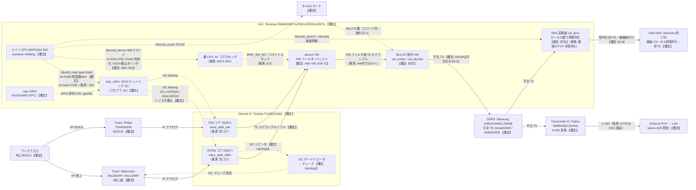

# SB-TV06-WRIP 信号・制御フロー俯瞰図

<!-- openird-spec
Status: observing
As-of:  実機 SB-TV06-WRIP (2026-09-26) ＋ 3機種アーキ比較 (2026-09-30)
Impl:   -
Tests:  -
Note:   物理IC/論理単位と放送データ・制御の流れの俯瞰。詳細は sb-tv06-wrip-bringup.md（§1/§5/§9）。
        2026-09-30 に3機種比較を「補足」へ追記（WFPL 生TS不可の確定=stage-b-fapex §5.8/§5.10 を反映。WRIP 実機観察は 2026-09-26 のまま）。
-->

<!-- Open 層: 基板写真の型番シルク、実機の lsmod / /proc/kallsyms のシンボル名 /
     LD_PRELOAD ioctl トレース / /dev/mem の TS 走査（0x47 同期・スクランブル統計）/
     公開 GPL(r557) の静的読み から構成。逆アセ由来の内部ロジック・コード由来の数式・
     限定受信の鍵/手順は含まない。【確定】は実機または写真で確認、（推測）は状況証拠からの推定。 -->

## 凡例

- **ノード**: 実線の枠＝**物理 IC（1 チップ）**。点線の枠＝**IC 内の論理単位**。
- **エッジ**: 実線 `──▶` ＝**放送データの流れ**。点線 `┄┄▶` ＝**制御の流れ**。
  ラベルに**バス種別・制御内容・データ内容**を表記。
- **確度**: **【確定】**＝実機/写真で確認。**（推測）**＝状況証拠からの推定。

## ブロック図

## 補足（確度の内訳と OpenIRD の関わり）

- **【確定】の主なもの**: 全 IC の型番（写真・lsmod）、ei2c が zpio の GPIO ビットバング I2C で
  SCL=GPIO29/SDA=GPIO0（実機観察・§7.2）、チューナが demod の I2C ゲート奥（demod driver の
  シンボル・§5.2）、`fe_main` の周波数が MHz（§9.1）、demux の ABI が YB1 と一致（§5.1）、
  復号がインラインで DRAM には平文 TS しか持続しない（§9.2）、録画が非 TS のローカル再暗号化（§9.4）。
- **（推測）の主なもの**: 裏 CPU が MIPS 4KE（YB1 由来・WRIP で未直接確認）、demod の OFDM/PSK が
  別コア（slave_addr が 2 つあることから）、demux→descramble が HW 内で連結（散在片しか無いことから）、
  裏 CPU の合図が §72 と同形式（未検証）、BS の nr=0x0a=TSID。
- **★ OpenIRD の生 TS タップ点**: `DEMUX`（PID フィルタ後・スクランブル TS）を、`DSC`（復号）を
  **バイパス**して DRAM に書かせる（§72 のクリーン demux 制御）＝スクランブル TS を chardev で出す。
  復号は下流の正規 B-CAS+PC/SC に委ねる（scope 準拠）。`tsout_demux`/StreamOut は視聴・録画とも
  未使用（§9.3/§9.4）＝生 TS の出口は自前で demux 出力を確保するのが本線。
- **触れない**: `DSC`（MULTI2）と `BCAS` の鍵・手順（限定受信＝永久スコープ外）。

## 3 機種アーキテクチャの比較（なぜ WRIP が生 TS の本命か・2026-09-30 追記）

同じ B-CAS＋Dione(MB86H58) を持つ WFPL と、B-CAS 無しの YB1 を並べると WRIP の位置づけが
はっきりする。**分かれ目は「復号がどこで起きるか」**。WFPL は今セッション（2026-09-30）に
「ソフトから生 TS は取れない」が**確定**した（`sb-tv02-wfpl-stage-b-fapex.md` §5.8/§5.10。カード
有無に依らず素通し無し）ので、対比が確かなものになった。

| 機種 | SoC | 復号の場所 | Dione(MB86H58) の役割 | 生（スクランブル）TS の所在 | ソフトで生 TS |
|---|---|---|---|---|---|
| YB1 (BMMPX1301) | Renesas EMMA3SEP | **無し**（B-CAS 無し） | 非搭載 | 復調後そのまま SoC の AV SRAM 入力 FIFO | **可・実証**（reception-stack §87） |
| WFPL (SB-TV02) | Fujitsu MB86H61 | **Dione の中**（インライン別チップ・カードも Dione 配下） | 復号＋トランスコード | demod→Dione の基板配線上のみ・SoC は復号後しか見えない | **不可・確定**（stage-b-fapex §5.8/§5.10） |
| **WRIP (BR310L)** | Renesas EMMA3SEP | **SoC の HW**（`val_dscram`/`val_m2dsc`・カードは SoC 側 `val_scard`） | **トランスコードのみ**（DRAM の平文 TS を受け H.264 化＝§9.3） | demux→復号ステージの間（SoC 内 HW） | **（推測）タップ可**：demux（§72 の YB1 互換 ABI）を自前駆動し復号ステージをバイパス |

- ★ **要点**: WFPL は復号が**触れない別チップ(Dione)にインライン**で入るため、SoC は復号後しか
  見えずソフトから生 TS を取れない（確定）。**WRIP は復号が SoC 自身の HW にあり、しかもその
  demux は YB1 と同一 ABI（§5.1）で自前駆動できる。Dione は DRAM の平文を受ける下流の
  トランスコーダに過ぎない**（WFPL の Dione＝復号器、とは役割が逆）。∴ **「demux で PID フィルタ
  後の TS を、復号ステージを通さずに DRAM へ落とす」タップがアーキ上成立し得るのは WRIP だけ**
  （WFPL では原理的に不可、YB1 は復号段が無く既に取れている）。これが WRIP を生 TS・カードの
  本命に置く理由。
- **カード（PC/SC）**: WFPL はカードが Dione プロプラ配下で標準リーダとして SoC に見えない
  （実用上 deferred）。**WRIP はカードが SoC 側の `val_scard`**＝透過リーダの余地がある（スコープ内・
  復号は下流）。この点でも WRIP が本命。
- **未検証（要 RF 信号＋実機）**: この「復号バイパス」タップが実機で本当に成立するか（§6-1・§9.2 の
  設計）。裏 CPU の合図が YB1 §72 と同形式か（demux 76 本 ABI は一致済み・§5.1）。
