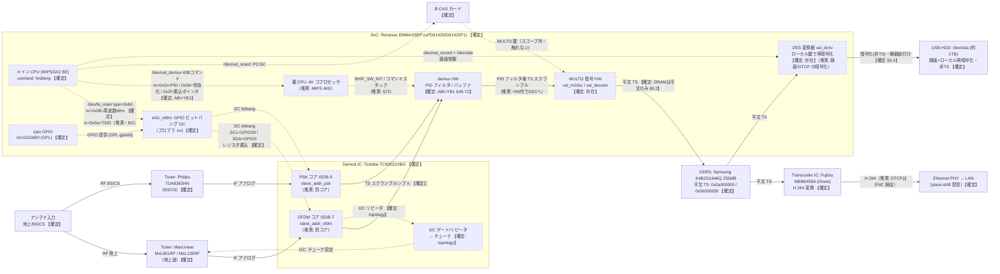

# SB-TV06-WRIP 信号・制御フロー俯瞰図

<!-- openird-spec
Status: observing
As-of:  実機 SB-TV06-WRIP (2026-09-26)
Impl:   -
Tests:  -
Note:   物理IC/論理単位と放送データ・制御の流れの俯瞰。詳細は sb-tv06-wrip-bringup.md（§1/§5/§9）。
-->

<!-- Open 層: 基板写真の型番シルク、実機の lsmod / /proc/kallsyms のシンボル名 /
     LD_PRELOAD ioctl トレース / /dev/mem の TS 走査（0x47 同期・スクランブル統計）/
     公開 GPL(r557) の静的読み から構成。逆アセ由来の内部ロジック・コード由来の数式・
     限定受信の鍵/手順は含まない。【確定】は実機または写真で確認、（推測）は状況証拠からの推定。 -->

## 凡例

- **ノード**: 実線の枠＝**物理 IC（1 チップ）**。点線の枠＝**IC 内の論理単位**。
- **エッジ**: 実線 `──▶` ＝**放送データの流れ**。点線 `┄┄▶` ＝**制御の流れ**。
  ラベルに**バス種別・制御内容・データ内容**を表記。
- **確度**: **【確定】**＝実機/写真で確認。**（推測）**＝状況証拠からの推定。

## ブロック図

## 補足（確度の内訳と OpenIRD の関わり）

- **【確定】の主なもの**: 全 IC の型番（写真・lsmod）、ei2c が zpio の GPIO ビットバング I2C で
  SCL=GPIO29/SDA=GPIO0（実機観察・§7.2）、チューナが demod の I2C ゲート奥（demod driver の
  シンボル・§5.2）、`fe_main` の周波数が MHz（§9.1）、demux の ABI が YB1 と一致（§5.1）、
  復号がインラインで DRAM には平文 TS しか持続しない（§9.2）、録画が非 TS のローカル再暗号化（§9.4）。
- **（推測）の主なもの**: 裏 CPU が MIPS 4KE（YB1 由来・WRIP で未直接確認）、demod の OFDM/PSK が
  別コア（slave_addr が 2 つあることから）、demux→descramble が HW 内で連結（散在片しか無いことから）、
  裏 CPU の合図が §72 と同形式（未検証）、BS の nr=0x0a=TSID。
- **★ OpenIRD の生 TS タップ点**: `DEMUX`（PID フィルタ後・スクランブル TS）を、`DSC`（復号）を
  **バイパス**して DRAM に書かせる（§72 のクリーン demux 制御）＝スクランブル TS を chardev で出す。
  復号は下流の正規 B-CAS+PC/SC に委ねる（scope 準拠）。`tsout_demux`/StreamOut は視聴・録画とも
  未使用（§9.3/§9.4）＝生 TS の出口は自前で demux 出力を確保するのが本線。
- **触れない**: `DSC`（MULTI2）と `BCAS` の鍵・手順（限定受信＝永久スコープ外）。
